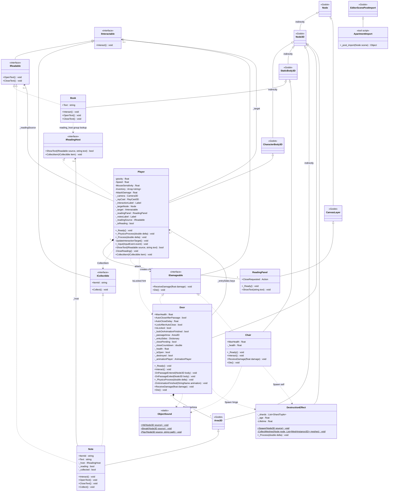
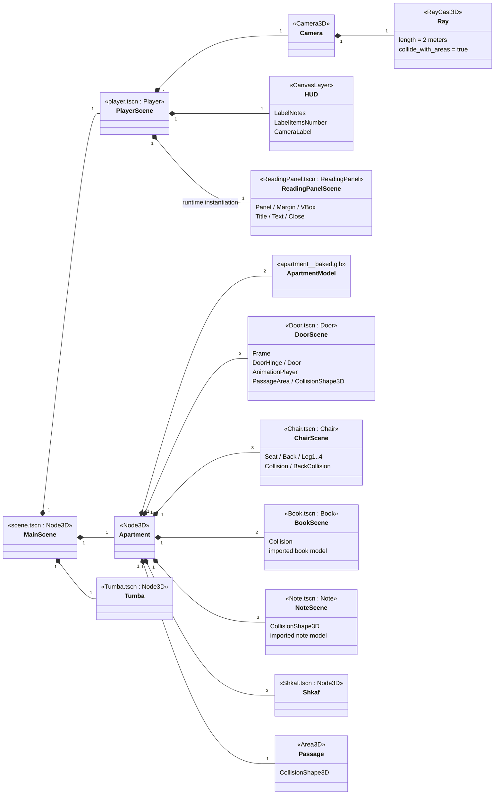
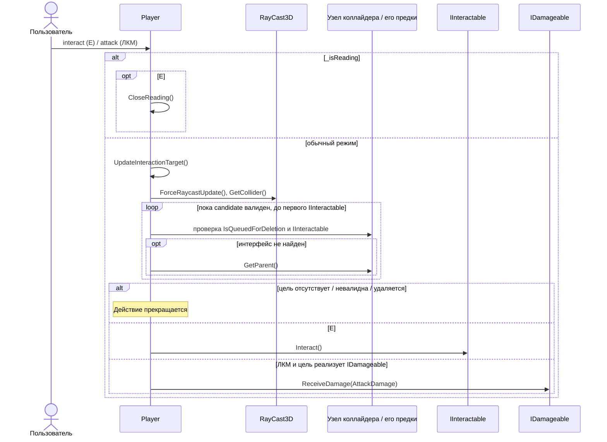
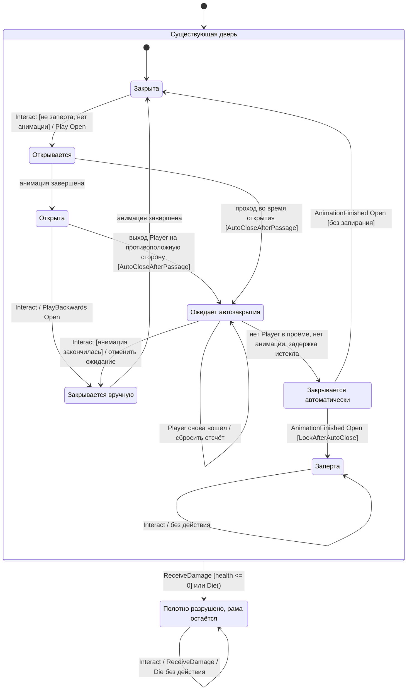
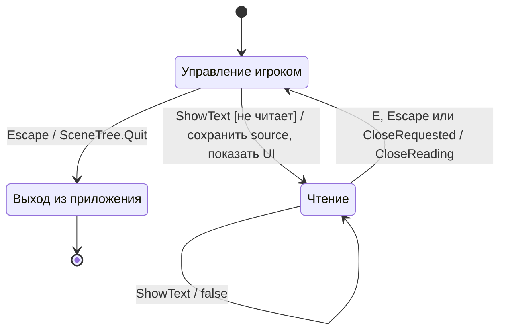
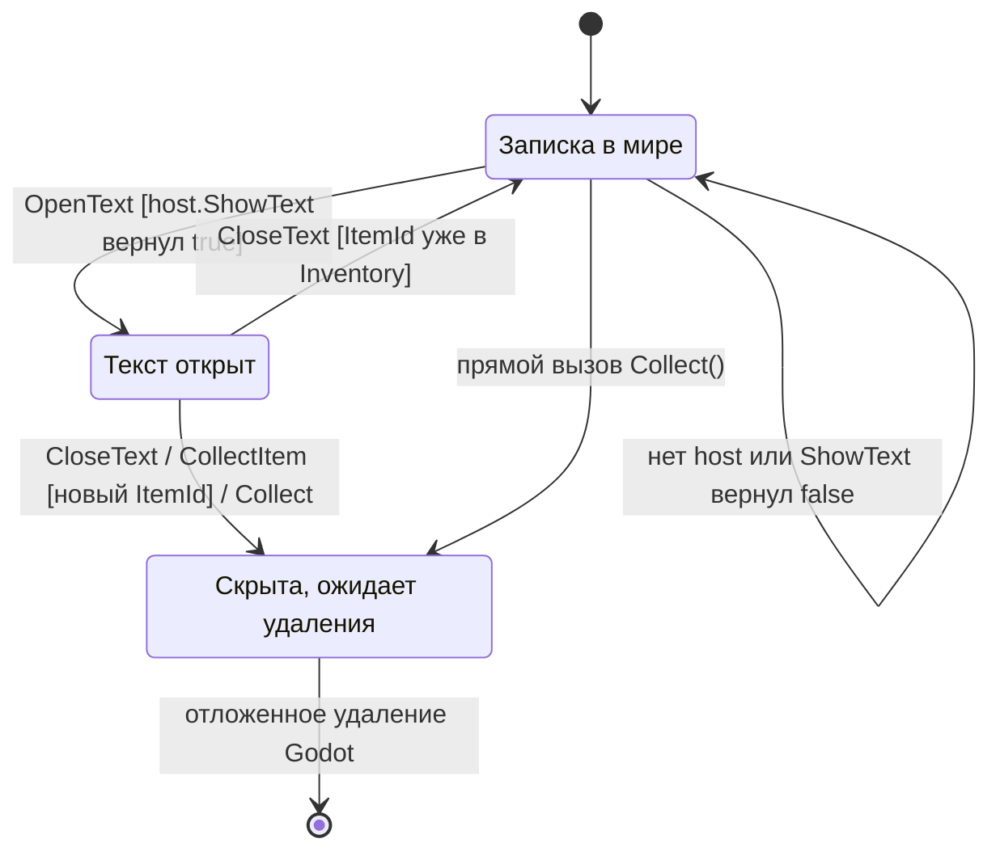
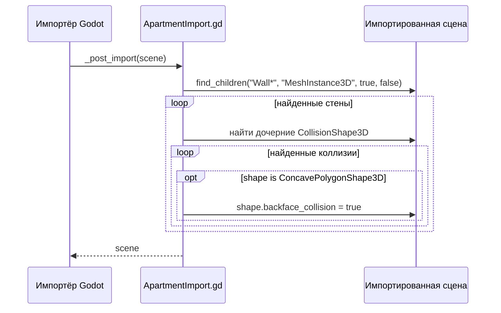

# UML проекта learning-project-4

Диаграммы составлены по исходному коду `scripts/`, сценам `scenes/`, ресурсам импорта и настройкам проекта. Они описывают существующую реализацию. Mermaid-блоки отображаются в Markdown-просмотрщиках с поддержкой Mermaid, включая GitHub. Полная диаграмма классов также доступна в `classes.puml` для PlantUML.

## 1. Архитектура и границы

Это прототип игры от первого лица на Godot: C# отвечает за игровую логику, GDScript — за обработку модели квартиры при импорте. В `.csproj` указан Godot.NET.Sdk 4.7.2, целевая платформа — net8.0, для Android — net9.0. Главная сцена — `scenes/scene.tscn`.

| Часть | Ответственность |
| --- | --- |
| Player | Движение, обзор, выбор цели, взаимодействие, атака, чтение, инвентарь |
| IInteractable и производные интерфейсы | Контракты взаимодействия, чтения, подбора и получения урона |
| IReadingHost | Контракт показа текста и передачи предмета в инвентарь |
| ReadingPanel | Общее окно чтения и событие запроса закрытия |
| Book, Note | Повторное чтение книги; чтение и последующий подбор записки |
| Door, Chair | Получение урона и разрушение; у двери также анимация и автозакрытие |
| ObjectSound, DestructionEffect | Независимые от удаляемого предмета звук и осколки |
| ApartmentImport.gd | Двусторонние вогнутые коллизии стен при импорте |

В проекте нет отдельных классов Inventory, GameManager, сервера или базы данных. Инвентарь — массив строк внутри Player. `ApartmentImport` на диаграмме — имя файла скрипта: `class_name` в GDScript не объявлен.

## 2. Полная диаграмма классов

Включены все 8 C#-классов, 5 интерфейсов, GDScript и все явно объявленные поля, свойства, методы и событие. Унаследованные члены Godot не разворачиваются. `+` — public, `-` — private, `$` — static. Свойства с `[Export]` доступны в инспекторе даже при private; readonly/const и ограничения set пояснены ниже. Типы Godot показаны только в необходимом объёме.



Примечания к точности модели:

- `CloseRequested` — C#-событие `event Action`, Player подписывает на него `CloseReading`.
- `ICollectible.ItemId` имеет только get; в Note свойство имеет get/set. `Door.IsLocked` имеет public get/private set.
- `Inventory` — `Godot.Collections.Array<string>`, не коллекция объектов Note. Поле экспортируется в инспектор.
- `_entrySides` имеет тип `Dictionary<Player, float>`. `_entrySides` и `_shards` — readonly-ссылки на изменяемые коллекции. `ShardTuple` — обозначение кортежа `(MeshInstance3D Mesh, Vector3 Velocity, Vector3 Spin)`, отдельного класса с таким именем нет.
- `Lifetime` — private const float = 0.85. У эффекта 32 осколка; это визуальные MeshInstance3D, не физические тела.
- Промежуточные базовые классы Godot, например PhysicsBody3D и CollisionObject3D, опущены; связи `indirectly` означают транзитивное наследование.
- Композиция Player–ReadingPanel относится к состоянию после `_Ready()`. Остальные ссылки на цель/источник/host могут отсутствовать.

## 3. Композиция сцен и ресурсов

Это UML-представление объектов сцен, а не дополнительные C#-классы. Количества относятся к текущей `scene.tscn`; дерево импортированных GLB-моделей свёрнуто.



Player также содержит MeshInstance3D и CollisionShape3D. У первой двери в основной сцене включены `AutoCloseAfterPassage` и `LockAfterAutoClose`. У записок идентификаторы `note_01`, `note_02` и унаследованный `note`. Шкафы и тумба не имеют скриптов взаимодействия. `resources/Furniture.tscn` — вспомогательная сцена модели мебели, из основной сцены напрямую не инстанцируется. Area3D непосредственно под Apartment не имеет подключённого скрипта.

## 4. Выбор цели и выполнение действия



Выбор цели также выполняется каждый `_Process`. Подсказка учитывает запертую дверь. `Chair.Interact()` пустой: клавиша E для стула не выполняет действия, хотя общая подсказка появляется.

## 5. Чтение книги и сбор записки

```mermaid
sequenceDiagram
actor U as Пользователь
participant P as Player / IReadingHost
participant S as Book или Note
participant Tree as SceneTree
participant UI as ReadingPanel
U->>P: E при наведении
P->>S: Interact() → OpenText()
S->>Tree: GetFirstNodeInGroup("reading_host")
Tree-->>S: IReadingHost или null
opt host найден; Note не читается и не собрана
  S->>P: ShowText(this, Text)
  alt Player уже читает
    P-->>S: false
  else окно доступно
    P->>P: сохранить source; _isReading = true
    P->>UI: ShowText(text)
    UI->>UI: текст, прокрутка к началу, Show, фокус кнопки
    P->>P: курсор Visible
    P-->>S: true
    Note over S: Note сохраняет host и _reading = true
    Note over P: Движение по X/Z, обзор и атака заблокированы; гравитация действует
    alt кнопка закрытия
      U->>UI: Pressed
      UI-->>P: CloseRequested
    else E / Escape
      U->>P: interact / quit
    end
    P->>P: CloseReading(): сбросить source и _isReading
    P->>UI: Hide()
    P->>P: курсор Captured
    opt source — существующий GodotObject
      P->>S: CloseText()
      alt Book
        Note over S: Пустой метод; книга остаётся в мире
      else Note
        S->>S: _reading = false
        S->>P: CollectItem(this)
        alt Inventory уже содержит ItemId
          Note over P,S: Возврат без Collect(); записка остаётся в мире
        else новый ItemId
          P->>P: Inventory.Add(ItemId), обновить счётчик
          P->>S: Collect()
          S->>S: _collected = true; Hide(); QueueFree()
          P->>P: сбросить цель и подсказку
        end
      end
    end
  end
end
```

## 6. Получение урона и разрушение

```mermaid
sequenceDiagram
participant P as Player
participant O as Door / Chair
participant Sound as ObjectSound
participant FX as DestructionEffect
participant Scene as CurrentScene
P->>O: ReceiveDamage(10)
alt damage <= 0 или объект уже уничтожен/удаляется
  Note over O: Возврат без изменений
else допустимый урон
  O->>Sound: Hit(this)
  Sound->>Scene: добавить AudioStreamPlayer3D, Play()
  O->>O: _health -= damage
  opt _health <= 0
    O->>O: Die()
    O->>Sound: Break(this)
    Sound->>Scene: добавить отдельный AudioStreamPlayer3D
    alt Door
      O->>O: _destroyed = true; сбросить флаги и _entrySides; Stop()
      O->>FX: Spawn(DoorHinge)
      O->>O: DoorHinge.QueueFree(); рама остаётся
    else Chair
      O->>FX: Spawn(this)
      O->>O: QueueFree()
    end
    opt найдена видимая геометрия
      FX->>Scene: добавить DestructionEffect с 32 осколками
      loop _Process до Lifetime = 0.85 s
        FX->>FX: гравитация, движение, вращение, уменьшение
      end
      FX->>FX: QueueFree()
    end
  end
end
Note over Sound,Scene: После Finished каждый источник звука вызывает QueueFree()
```

Внутри `Door.Die()` флаг `_destroyed` устанавливается перед `ObjectSound.Break`; на схеме общий звук сгруппирован с логикой разрушения. Звук пропускается, если ресурс не загрузился. Эффект пропускается, если нет видимых MeshInstance3D с Mesh. По умолчанию стул имеет 10 HP, дверь — 50 HP, атака — 10: нужны соответственно 1 и 5 попаданий.

## 7. Состояния двери

Состояния ниже — аналитическое представление комбинаций bool-полей и AnimationPlayer. Отдельного enum состояний в коде нет. `_isOpen` переключается при запуске анимации; визуальная дверь завершает движение позже.



Для распознавания прохода сравниваются знаки локальной Z-координаты входа и выхода (`entrySide * exitSide < 0`). Возврат на ту же сторону не создаёт нового ожидания закрытия. Отсчёт не уменьшается, пока Player находится в зоне или проигрывается анимация. Публичного способа отпереть дверь нет; запертую дверь можно разрушить.

## 8. Состояния игрока и записки





## 9. Импорт квартиры



Этот скрипт подключён через `import_script/path` в `resources/apartment_baked/apartment__baked.glb.import` и работает в редакторе при импорте.

## 10. Выводы анализа

- Интерфейсы позволяют Player вызывать действия без знания конкретного типа предмета. Исключение — проверка `Door.IsLocked` для специальной подсказки.
- Player объединяет несколько обязанностей: управление, UI, инвентарь и диспетчеризацию взаимодействий. При расширении проекта их можно выделить в компоненты, но в текущих диаграммах сохранена фактическая структура.
- Поиск `reading_host` через группу предполагает первого подходящего владельца; выбор конкретного игрока при нескольких игроках не реализован.
- Повторяющийся ItemId предотвращает добавление в массив, но оставляет вторую записку в мире: `CollectItem` возвращается до `Collect`. Это отражено в сценарии чтения.
- `ICollectible` и `IDamageable` наследуют `IInteractable`, поэтому любой такой предмет попадает в общую систему подсказок; для Chair действие E пустое.
- Звук и осколки добавляются в CurrentScene и продолжают существовать после удаления предмета. Дверь сохраняет корневой узел и раму после разрушения.

Проверка выполнена по исходным файлам и связям ресурсов. Игровой код не изменён. Схемы не являются результатом запуска игры; исходники моделей GLB и унаследованный API движка полностью не разворачиваются.
